<h3><code>rachi2006@github ~ $ whoami</code></h3>

<table>
<tr>
<td valign="top"></td>
<td valign="top"></td>
</tr>
</table>

 
 

<h3><code>rachi2006@github ~ $ ./contributions.sh</code></h3>

 
 

<h3><code>rachi2006@github ~ $ ./links.sh</code></h3>

<b>Aspiring Data Scientist · AI & Data Science · Python & SQL</b>

 

<h3><code>rachi2006@github ~ $ cat about.md</code></h3>

- 🎓 Final-year B.Tech CSE (Artificial Intelligence & Data Science) student at **Parul University**
- 📊 Aspiring **Data Analyst / Data Scientist**, learning and building with Python, NumPy, Pandas and SQL
- 🛠️ Also building web apps with Flask, Django and MongoDB
- 🚀 Open to opportunities

<h3><code>rachi2006@github ~ $ ls ./stack</code></h3>

 
 

<h3><code>rachi2006@github ~ $ ls ./projects</code></h3>

| Project | What it is |
| --- | --- |
| [**SkillPath**](https://github.com/rachi2006/SkillPath) | Flask + MongoDB roadmap generator web app · [live demo](https://skillpath-sc6x.onrender.com) |
| [**NOVA AI Agent**](https://github.com/rachi2006/nova-ai_agent) | Personal AI voice assistant with wake-word activation |
| [**DevMind**](https://github.com/rachi2006/devmind) | Developer project, see the repo for details |
| [**Data_about_AI**](https://github.com/rachi2006/Data_about_AI) | Data project on AI |
| [**DSA_solutions**](https://github.com/rachi2006/DSA_solutions) | Data structures & algorithms solutions |
| [**learn_skills**](https://github.com/rachi2006/learn_skills) | Developer growth dashboard to track learning, streaks and notes |

<h3><code>rachi2006@github ~ $ ls ./certifications</code></h3>

- Deloitte Australia — Data Analytics Job Simulation (Forage, June 2026)
- Tata — Data Visualisation: Empowering Business with Effective Insights (Forage, June 2026)
- AWS Academy Graduate — Cloud Foundations (March 2026)

 

The portrait, wordmark and contribution graph above are self-hosted SVGs. The graph refreshes daily through GitHub Actions.

